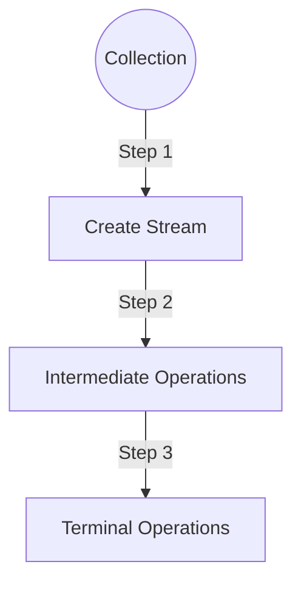
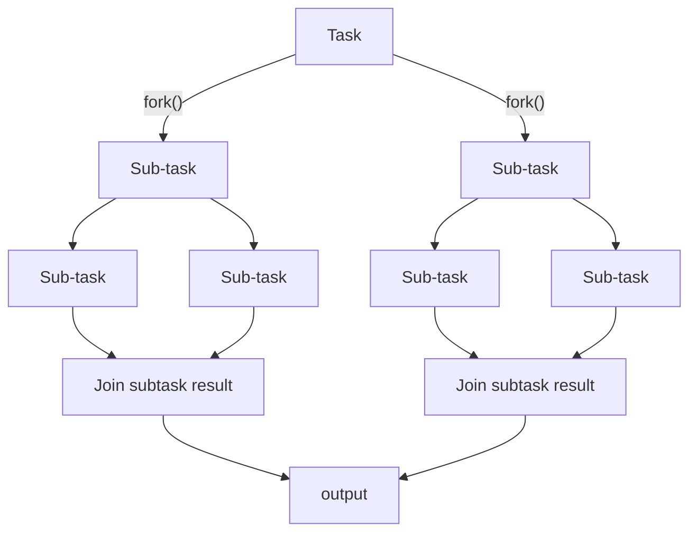

# STREAMS in Java 8

*"Concept && Coding" YT Video Notes*

---

## Stream (Java 8)

### What is Stream?

- We can consider Stream as a **pipeline**, through which our collection elements pass through.
- While elements pass through the pipeline, it performs various operations like sorting, filtering etc.
- Useful when dealing with bulk processing (can do parallel processing).

### Stream Flow



**At Step 1:** Streams are created from the data source like a collection or array etc.

**At Step 2:**
- Intermediate operations like `filter()`, `sorted()`, `map()`, `distinct()` etc. are used.
- These operations transform the stream into another stream, and more operations can be done on top of it.
- These are **lazy** in nature, meaning these operations get executed only when a terminal operation is invoked.

**At Step 3:**
- Terminal operations like `collect()`, `reduce()`, `count()` etc. are used.
- These operations trigger the processing of the stream.
- And produce the output. Once a terminal operation is used, no more operations can be performed.

### For Example

**Without Stream:**

```java
public class StreamExample {

    public static void main(String args[]) {

        List<Integer> salaryList = new ArrayList<>();
        salaryList.add(3000);
        salaryList.add(4100);
        salaryList.add(9000);
        salaryList.add(1000);
        salaryList.add(3500);

        int count = 0;
        for (Integer salary : salaryList) {
            if (salary > 3000) {
                count++;
            }
        }

        System.out.println("Total Employee with salary > 3000: " + count);
    }
}
```

**Using Stream:**

```java
public class StreamExample {

    public static void main(String args[]) {

        List<Integer> salaryList = new ArrayList<>();
        salaryList.add(3000);
        salaryList.add(4100);
        salaryList.add(9000);
        salaryList.add(1000);
        salaryList.add(3500);

        long output = salaryList.stream().filter((Integer sal) -> sal > 3000).count();
        System.out.println("Total Employee with salary > 3000: " + output);
    }
}
```

**Output:**

```
Total Employee with salary > 3000: 3
```

---

## Different Ways to Create a Stream

### 1. From Collection

```java
List<Integer> salaryList = Arrays.asList(3000, 4100, 9000, 1000, 3500);
Stream<Integer> streamFromIntegerList = salaryList.stream();
```

### 2. From Array

```java
Integer[] salaryArray = {3000, 4100, 9000, 1000, 3500};
Stream<Integer> streamFromIntegerArray = Arrays.stream(salaryArray);
```

### 3. From Static Method

```java
Stream<Integer> streamFromStaticMethod = Stream.of(1000, 3500, 4000, 9000);
```

### 4. From Stream Builder

```java
Stream.Builder<Integer> streamBuilder = Stream.builder();
streamBuilder.add(1000).add(9000).add(3500);

Stream<Integer> streamFromStreamBuilder = streamBuilder.build();
```

### 5. From Stream Iterate

```java
Stream<Integer> streamFromIterate = Stream.iterate(1000, (Integer n) -> n + 5000).limit(5);
```

---

## Different Intermediate Operations

We can chain multiple intermediate operations together to perform more complex processing before applying a terminal operation to produce the result.

| No. | Intermediate Operation | Description |
|-----|------------------------|-------------|
| 1 | `filter(Predicate<T> predicate)` | Filters the elements. |
| 2 | `map(Function<T, R> mapper)` | Used to transform each element. |
| 3 | `flatMap(Function<T, Stream<R>> mapper)` | Used to iterate over each element of a complex collection, and helps to flatten it. |
| 4 | `distinct()` | Removes duplicates from the stream. |
| 5 | `sorted()` | Sorts the elements. |
| 6 | `peek(Consumer<T> action)` | Helps you see the intermediate result of the stream being processed. |
| 7 | `limit(long maxSize)` | Truncates the stream to be no longer than the given maxSize. |
| 8 | `skip(long n)` | Skips the first n elements of the stream. |
| 9 | `mapToInt(ToIntFunction<T> mapper)` | Helps to work with primitive `int` data types. |
| 10 | `mapToLong(ToLongFunction<T> mapper)` | Helps to work with primitive `long` data types. |
| 11 | `mapToDouble(ToDoubleFunction<T> mapper)` | Helps to work with primitive `double` data types. |

### 1. `filter(Predicate<T> predicate)`

Filters the elements.

```java
Stream<String> nameStream = Stream.of("HELLO", "EVERYBODY", "HOW", "ARE", "YOU", "DOING");
Stream<String> filteredStream = nameStream.filter((String name) -> name.length() <= 3);

List<String> filteredNameList = filteredStream.collect(Collectors.toList());
//OUTPUT: HOW, ARE, YOU
```

### 2. `map(Function<T, R> mapper)`

Used to transform each element.

```java
Stream<String> nameStream = Stream.of("HELLO", "EVERYBODY", "HOW", "ARE", "YOU", "DOING");
Stream<String> filteredNames = nameStream.map((String name) -> name.toLowerCase());
//OUTPUT: hello, everybody, how, are, you, doing
```

### 3. `flatMap(Function<T, Stream<R>> mapper)`

Used to iterate over each element of a complex collection, and helps to flatten it.

```java
List<List<String>> sentenceList = Arrays.asList(
        Arrays.asList("I", "LOVE", "JAVA"),
        Arrays.asList("CONCEPTS", "ARE", "CLEAR"),
        Arrays.asList("ITS", "VERY", "EASY")
);

Stream<String> wordsStream1 = sentenceList.stream()
        .flatMap((List<String> sentence) -> sentence.stream());
//Output: I, LOVE, JAVA, CONCEPTS, ARE, CLEAR, ITS, VERY, EASY

Stream<String> wordsStream2 = sentenceList.stream()
        .flatMap((List<String> sentence) -> sentence.stream().map((String value) -> value.toLowerCase()));
//Output: i, love, java, concepts, are, clear, its, very, easy
```

### 4. `distinct()`

Removes duplicates from the stream.

```java
Integer[] arr = {1, 5, 2, 7, 4, 4, 2, 0, 9};

Stream<Integer> arrStream = Arrays.stream(arr).distinct();
//Output: 1, 5, 2, 7, 4, 0, 9
```

### 5. `sorted()`

Sorts the elements.

```java
Integer[] arr = {1, 5, 2, 7, 4, 4, 2, 0, 9};

Stream<Integer> arrStream = Arrays.stream(arr).sorted();
//Output: 0, 1, 2, 2, 4, 4, 5, 7, 9
```

With a custom comparator (descending):

```java
Integer[] arr = {1, 5, 2, 7, 4, 4, 2, 0, 9};

Stream<Integer> arrStream = Arrays.stream(arr).sorted((Integer val1, Integer val2) -> val2 - val1);
//Output: 9, 7, 5, 4, 4, 2, 2, 1, 0
```

### 6. `peek(Consumer<T> action)`

Helps you see the intermediate result of the stream being processed.

```java
List<Integer> numbers = Arrays.asList(2, 1, 3, 4, 6);
Stream<Integer> numberStream = numbers.stream()
        .filter((Integer val) -> val > 2)
        .peek((Integer val) -> System.out.println(val)) //it will print 3, 4, 6
        .map((Integer val) -> -1 * val);
List<Integer> numberList = numberStream.collect(Collectors.toList());
```

### 7. `limit(long maxSize)`

Truncates the stream to be no longer than the given maxSize.

```java
List<Integer> numbers = Arrays.asList(2, 1, 3, 4, 6);
Stream<Integer> numberStream = numbers.stream().limit(3);

List<Integer> numberList = numberStream.collect(Collectors.toList());
//Output: 2, 1, 3
```

### 8. `skip(long n)`

Skips the first n elements of the stream.

```java
List<Integer> numbers = Arrays.asList(2, 1, 3, 4, 6);
Stream<Integer> numberStream = numbers.stream().skip(3);

List<Integer> numberList = numberStream.collect(Collectors.toList());
//Output: 4, 6
```

### 9. `mapToInt(ToIntFunction<T> mapper)`

Helps to work with primitive `int` data types.

```java
List<String> numbers = Arrays.asList("2", "1", "4", "7");
IntStream numberStream = numbers.stream().mapToInt((String val) -> Integer.parseInt(val));

int[] numberArray = numberStream.toArray();
//Output: 2, 1, 4, 7

int[] numbersArray = {2, 1, 4, 7};
IntStream numbersStream = Arrays.stream(numbersArray);
numbersStream.filter((int val) -> val > 2);
int[] filteredArray = numbersStream.toArray();
//Output: 4, 7
```

### 10. `mapToLong(ToLongFunction<T> mapper)`

Helps to work with primitive `long` data types. *(pls try it out....)*

### 11. `mapToDouble(ToDoubleFunction<T> mapper)`

Helps to work with primitive `double` data types. *(pls try it out....)*

---

## Why We Call Intermediate Operations "Lazy"

```java
public class StreamExample {

    public static void main(String args[]) {

        List<Integer> numbers = Arrays.asList(2, 1, 4, 7, 10);
        Stream<Integer> numbersStream = numbers.stream().filter((Integer val) -> val >= 3).peek((Integer val) -> System.out.println(val));
    }
}
```

**Output:** Nothing would be printed in the output.

```java
public class StreamExample {

    public static void main(String args[]) {

        List<Integer> numbers = Arrays.asList(2, 1, 4, 7, 10);
        Stream<Integer> numbersStream = numbers.stream().filter((Integer val) -> val >= 3).peek((Integer val) -> System.out.println(val));

        numbersStream.count(); //count is one of the terminal operation
    }
}
```

**Output:**

```
4
7
10
```

---

## Sequence of Stream Operations

```java
public class StreamExample {

    public static void main(String args[]) {

        List<Integer> numbers = Arrays.asList(2, 1, 4, 7, 10);
        Stream<Integer> numbersStream = numbers.stream()
                .filter((Integer val) -> val >= 3)
                .peek((Integer val) -> System.out.println("after filter:" + val))
                .map((Integer val) -> (val * -1))
                .peek((Integer val) -> System.out.println("after negating:" + val))
                .sorted()
                .peek((Integer val) -> System.out.println("after Sorted:" + val));

        List<Integer> filteredNumberStream = numbersStream.collect(Collectors.toList());
    }
}
```

| Expected Output | Actual Output |
|-----------------|---------------|
| after filter: 4 | after filter: 4 |
| after filter: 7 | after negating: -4 |
| after filter: 10 | after filter: 7 |
| after negating: -4 | after negating: -7 |
| after negating: -7 | after filter: 10 |
| after negating: -10 | after negating: -10 |
| after Sorted: -10 | after Sorted: -10 |
| after Sorted: -7 | after Sorted: -7 |
| after Sorted: -4 | after Sorted: -4 |

### How elements flow through the pipeline

Input: `2  1  4  7  10`

```
        │ 2
   ┌────▼────┐
   │ FILTER  │
   └────┬────┘
        │ 2
   ┌────▼────┐
   │  PEEK   │    ─┐
   └────┬────┘     │  Generally each element is processed sequentially and
        │ 2        │  can go through multiple operations. This feature helps
   ┌────▼────┐     │  Stream process the task fast.
   │   MAP   │     │  For example: if you need to return any number which is
   └────┬────┘     │  greater than 3, processing will stop at 4 itself.
        │ 2        │
   ┌────▼────┐     │
   │  PEEK   │    ─┘
   └─────────┘
   ┌─────────┐
   │ SORTED  │    ←  All stream elements should be present before this operation starts.
   └─────────┘
   ┌─────────┐
   │  PEEK   │
   └─────────┘
```

---

## Different Terminal Operations

Terminal operations are the ones that produce the result. They trigger the processing of the stream.

| No. | Terminal Operation | Description |
|-----|--------------------|-------------|
| 1 | `forEach(Consumer<T> action)` | Performs an action on each element of the stream. **Does NOT return any value.** |
| 2 | `toArray()` | Collects the elements of the stream into an array. |
| 3 | `reduce(BinaryOperator<T> accumulator)` | Does reduction on the elements of the stream. Performs an associative aggregation function. |
| 4 | `collect(Collector<T, A, R> collector)` | Can be used to collect the elements of the stream into a List. |
| 5 | `min(Comparator<T> comparator)` and `max(Comparator<T> comparator)` | Finds the minimum or maximum element from the stream based on the comparator provided. |
| 6 | `count()` | Returns the count of elements present in the stream. |
| 7 | `anyMatch(Predicate<T> predicate)` | Checks if any value in the stream matches the given predicate and returns a boolean. |
| 8 | `allMatch(Predicate<T> predicate)` | Checks if all values in the stream match the given predicate and returns a boolean. |
| 9 | `noneMatch(Predicate<T> predicate)` | Checks if no value in the stream matches the given predicate and returns a boolean. |
| 10 | `findFirst()` | Finds the first element of the stream. |
| 11 | `findAny()` | Finds any random element of the stream. |

### 1. `forEach(Consumer<T> action)`

Performs an action on each element of the stream. **Does NOT return any value.**

```java
List<Integer> numbers = Arrays.asList(2, 1, 4, 7, 10);
numbers.stream()
        .filter((Integer val) -> val >= 3)
        .forEach((Integer val) -> System.out.println(val));

//OUTPUT: 4, 7, 10
```

### 2. `toArray()`

Collects the elements of the stream into an array.

```java
List<Integer> numbers = Arrays.asList(2, 1, 4, 7, 10);

Object[] filteredNumberArrType1 = numbers.stream()
        .filter((Integer val) -> val >= 3)
        .toArray();

Integer[] filteredNumberArrType2 = numbers.stream()
        .filter((Integer val) -> val >= 3)
        .toArray((int size) -> new Integer[size]);
```

### 3. `reduce(BinaryOperator<T> accumulator)`

Does reduction on the elements of the stream. Performs an associative aggregation function.

```java
List<Integer> numbers = Arrays.asList(2, 1, 4, 7, 10);

Optional<Integer> reducedValue = numbers.stream()
        .reduce((Integer val1, Integer val2) -> val1 + val2);

System.out.println(reducedValue.get());
//output: 24
```

### 4. `collect(Collector<T, A, R> collector)`

Can be used to collect the elements of the stream into a List.

```java
List<Integer> numbers = Arrays.asList(2, 1, 4, 7, 10);

List<Integer> filteredNumber = numbers.stream()
        .filter((Integer val) -> val >= 3)
        .collect(Collectors.toList());
```

### 5. `min(Comparator<T> comparator)` and `max(Comparator<T> comparator)`

Finds the minimum or maximum element from the stream based on the comparator provided.

```java
List<Integer> numbers = Arrays.asList(2, 1, 4, 7, 10);

Optional<Integer> minimumValueType1 = numbers.stream()
        .filter((Integer val) -> val >= 3)
        .min((Integer val1, Integer val2) -> val1 - val2);

System.out.println(minimumValueType1.get());
//output: 4

Optional<Integer> minimumValueType2 = numbers.stream()
        .filter((Integer val) -> val >= 3)
        .min((Integer val1, Integer val2) -> val2 - val1);

System.out.println(minimumValueType2.get());
//output: 10
```

> *Can you pls comment the output for **max** for both the types?*

### 6. `count()`

Returns the count of elements present in the stream.

```java
List<Integer> numbers = Arrays.asList(2, 1, 4, 7, 10);

long noOfValuesPresent = numbers.stream()
        .filter((Integer val1) -> val1 >= 3)
        .count();

System.out.println(noOfValuesPresent);
//output: 3
```

### 7. `anyMatch(Predicate<T> predicate)`

Checks if any value in the stream matches the given predicate and returns a boolean.

```java
List<Integer> numbers = Arrays.asList(2, 1, 4, 7, 10);

boolean hasValueGreaterThanThree = numbers.stream()
        .anyMatch((Integer val) -> val > 3);

System.out.println(hasValueGreaterThanThree);
//output: true
```

### 8. `allMatch(Predicate<T> predicate)`

Checks if all values in the stream match the given predicate and returns a boolean. *(Can you pls try it out...)*

### 9. `noneMatch(Predicate<T> predicate)`

Checks if no value in the stream matches the given predicate and returns a boolean. *(Can you pls try it out...)*

### 10. `findFirst()`

Finds the first element of the stream.

```java
List<Integer> numbers = Arrays.asList(2, 1, 4, 7, 10);

Optional<Integer> firstValue = numbers.stream()
        .filter((Integer val) -> val >= 3)
        .findFirst();

System.out.println(firstValue.get());
//output: 4
```

### 11. `findAny()`

Finds any random element of the stream. *(Can you pls try it out...)*

---

## How Many Times Can We Use a Single Stream?

- Once a terminal operation is used on a stream, it is closed/consumed and cannot be used again for another terminal operation.

```java
List<Integer> numbers = Arrays.asList(2, 1, 4, 7, 10);

Stream<Integer> filteredNumbers = numbers.stream()
        .filter((Integer val) -> val >= 3);

filteredNumbers.forEach((Integer val) -> System.out.println(val)); // consumed the filteredNumbers stream

//trying to use the closed stream again
List<Integer> listFromStream = filteredNumbers.collect(Collectors.toList());
```

**Output:**

```
4
7
10
Exception in thread "main" java.lang.IllegalStateException: stream has already been operated upon or closed
    at StreamExample.main(StreamExample.java:19)
```

---

## Parallel Stream

- Helps to perform operations on a stream concurrently, taking advantage of multi-core CPUs.
- `parallelStream()` method is used instead of the regular `stream()` method.
- Internally it does:
  - **Task splitting:** it uses the "spliterator" function to split the data into multiple chunks.
  - **Task submission and parallel processing:** uses the **Fork-Join pool** technique.

> *Note: I will cover the Fork-Join pool implementation in the Multithreading topic.*

```java
public class StreamExample {

    public static void main(String args[]) {

        List<Integer> numbers = Arrays.asList(11, 22, 33, 44, 55, 66, 77, 88, 99, 110);

        // Sequential processing
        long sequentialProcessingStartTime = System.currentTimeMillis();
        numbers.stream()
                .map((Integer val) -> val * val)
                .forEach((Integer val) -> System.out.println(val));
        System.out.println("Sequential processing Time Taken: " + (System.currentTimeMillis() - sequentialProcessingStartTime) + " millisecond");

        // Parallel processing
        long parallelProcessingStartTime = System.currentTimeMillis();
        numbers.parallelStream()
                .map((Integer val) -> val * val)
                .forEach((Integer val) -> System.out.println(val));
        System.out.println("Parallel processing Time Taken: " + (System.currentTimeMillis() - parallelProcessingStartTime) + " millisecond");
    }
}
```

**Output:**

```
121
484
1089
1936
3025
4356
5929
7744
9801
12100
Sequential processing Time Taken: 64 millisecond
7744
121
5929
4356
1936
484
12100
1089
9801
3025
Parallel processing Time Taken: 5 millisecond
```

### Fork-Join Pool


